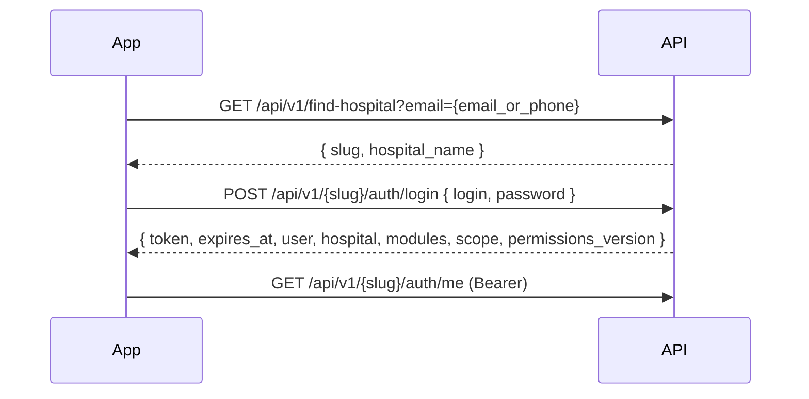

# Eye SaaS HMS — Mobile API Architecture Guide

Aa document ek jagya e badha important files no summary aape che: API routes, middleware, multi-tenancy, auth, patient API, ane PRD docs. Navo developer (ke AI) aa ek file vanchi ne poori API samji shake.

**Source files covered**

| # | File | Topic |
|---|------|-------|
| 1 | `routes/api.php` + `bootstrap/app.php` | Endpoints, prefixes, middleware aliases |
| 2 | `app/Http/Middleware/IdentifyTenant.php` | Slug thi tenant resolve |
| 3 | `app/Http/Middleware/CheckPermission.php` | RBAC permission check |
| 4 | `app/Traits/BelongsToTenant.php` | Automatic tenant isolation |
| 5 | `app/Http/Controllers/Api/AuthController.php` | 2-step mobile login |
| 6 | `app/Http/Controllers/Api/PatientApiController.php` | Patient CRUD reference |
| 7 | `docs/MOBILE_APP_PRD.md` | Business requirements |
| 8 | `docs/ROUND3_OT_MOBILE_API_PRD_PLAN.md` | OT workflow API plan |

---

## 1. Big Picture

- Backend: Laravel (multi-tenant, **path-based**), mobile auth = **Laravel Sanctum** bearer token.
- Web URL: `hmssaas.com/{slug}/patients`
- API URL: `hmssaas.com/api/v1/{slug}/patients`
- Har hospital = ek **tenant**, `slug` thi identify thay (e.g. `aakasheye`).
- Standard response:

```json
{ "success": true, "data": { }, "message": "..." }
```

Error: `success: false` + HTTP status (401, 403, 404, 409, 422).

**Request lifecycle (hospital API)**

```
Request  /api/v1/{slug}/patients
  → identify.tenant        (slug → Tenant, app('tenant') bind)
  → set.tenant.scope       (tenant scope set)
  → auth:sanctum           (Bearer token validate)
  → permissions.version    (X-Permissions-Version header add)
  → hospital.user.active   (user active chhe ke nahi)
  → subscription.active    (plan expired to block)
  → permission:patient_view (RBAC key check)
  → Controller → Model (BelongsToTenant global scope → WHERE tenant_id = ?)
```

---

## 2. `routes/api.php` ane `bootstrap/app.php`

### 2.1 Middleware aliases (`bootstrap/app.php`)

| Alias | Class | Kaam |
|-------|-------|------|
| `identify.tenant` | `IdentifyTenant` | URL slug thi tenant shodhe |
| `set.tenant.scope` | `SetTenantScope` | Tenant scope set kare |
| `auth.hospital` | `HospitalAuth` | Web session guard (hospital user) |
| `auth.superadmin` | `SuperAdminAuth` | Web super admin |
| `subscription.active` | `CheckSubscriptionActive` | Plan active hovo joiye |
| `grace.check` | `CheckGracePeriod` | Grace period handle |
| `redirect.inactive` | `RedirectIfInactive` | Inactive redirect |
| `permission` | `CheckPermission` | RBAC permission key |
| `role` | `CheckRole` | Role-based (session guard only!) |
| `platform.admin` | `EnsurePlatformAdmin` | Platform super admin API |
| `hospital.user.active` | `EnsureActiveHospitalApiUser` | API user active check |
| `permissions.version` | `AddPermissionsVersionHeader` | Permission version response header |

Extra: `NormalizeEmailInput` `web` ane `api` bane group ma append thayelu che (email lowercase). Razorpay `webhooks/*` CSRF thi exempt che.

### 2.2 Route structure (`routes/api.php`)

```
GET  /api/health                          → public health check

/api/v1
 ├── /super/...                           → Platform Super Admin API (no slug)
 │     POST /auth/login                   (public)
 │     [auth:platform_api + platform.admin]
 │       auth/logout, auth/me, dashboard
 │       hospitals (CRUD + activate/suspend/reactivate/extend/reseed-masters)
 │       payments, subscriptions, audit-logs, notifications
 │       plans, settings, profile
 │       location-master (countries/states/districts/cities)
 │       medicine-master (dosages/types/categories/routes/medicines)
 │
 ├── GET /find-hospital                   → public, email/phone → slug
 │
 └── /{slug}/...                          → Hospital Tenant API
       [identify.tenant + set.tenant.scope]
       POST /auth/login                   (public)
       POST /auth/logout                  (auth:sanctum)
       GET  /subscription, /subscription/invoice/{id}
            [auth:sanctum, permissions.version, hospital.user.active]
            → grace period ma pan accessible (subscription.active NATHI)
       [auth:sanctum, permissions.version, hospital.user.active, subscription.active]
            → badhu baki
```

### 2.3 Hospital API endpoint groups (authenticated)

| Group | Example endpoints | Permission style |
|-------|-------------------|------------------|
| Dashboard | `admin/dashboard`, `dashboard/today-patients`, `dashboard/doctor` | auth only / drill-downs ma `permission:` OR-groups |
| Drill-down widgets | `dashboard/collection`, `dashboard/ot-appointments`, `dashboard/doctor-ot` … | `patient_view\|report_view\|…` |
| Current user | `auth/me`, `modules` | auth only |
| Profile / Settings | `profile`, `settings`, `settings/logo`, `settings/change-password` | `setting_hospital_view/edit` |
| **Patients** | `patients`, `patients/{id}`, `patients/phone`, `patients/{id}/checkin`, `next-mrd`, `search-by-contact`, `phone-history`, `{id}/quick-personal`, `{id}/history` | `patient_view / register / register_phone / edit / delete`, `exam_history` |
| Masters (dropdowns) | `masters/cases`, `doctors`, `locations`, `slots`, `referrers` | auth only (locations create ma permission) |
| Masters CRUD | `masters/detail/{type}`, `case-types`, `referrers-crud`, `durations-crud`, OT masters | `casetype_*`, `referrer_*`, `duration_*`, `ot_*_add/edit/delete` |
| Exams | `exams/primary/{patientId}`, `exams/secondary/{patientId}` (GET+POST) | `exam_primary`, `exam_secondary` |
| Clinical queue | `clinical-queue` | `exam_primary\|exam_secondary` |
| **OT** | `ot/bookings`, `ot/recommend-surgery/{patientId}`, counsellor, appointments, ward, assistant, accountant, billing/print, inventory masters, `reports/ot` | `ot_*` keys (niche vistar ma) |
| Medicines | `medicines`, `medicine-groups`, `medicine-dosages/types/categories/routes/instructions` | `medicine_view/add/edit/delete` (GET ma exam_* pan allowed) |
| Reports | `reports`, `filter-data`, `channel-counts`, `export/excel|pdf` | `report_view\|opd_reports_view`, `report_export` |
| Users / Roles | `config/users`, `config/roles` | `user_*_view/add/edit/delete`, `role_*` |
| Share History | `share-history/patients|hospitals|connections|requests…` | `exam_history` |

### 2.4 OT route sub-groups (quick map)

| Area | Prefix | Key permission |
|------|--------|----------------|
| Counsellor | `ot/counsellor/*`, `ot/bookings/{id}/counselling|consent|send-to-billing` | `ot_counselling_fill`, `ot_consent_capture` |
| Appointments | `ot/appointments/*` | `ot_appointment_view/create/edit/confirm/cancel` |
| Ward | `ot/ward/bookings`, `ot/bookings/{id}/vitals|eye-drops|verification-header|mark-ready` | `ot_ward_entry`, `ot_preop_entry`, `ot_dilation_track` |
| Assistant | `ot/assistant/bookings`, `…/surgery`, `…/lens`, `ot/medicine-groups` | `ot_surgery_record`, `ot_lens_record|implant` |
| Accountant | `ot/accountant/*`, `…/payment-status`, `…/payments`, `…/refunds` | `ot_payment_record`, `ot_invoice_view` |
| Billing / Discharge | `ot/billing/bookings`, `…/invoice`, `…/print/*` (9 PDFs) | `ot_discharge_*`, `ot_bill_print`, `ot_billing_manage` |
| Inventory masters | `masters/ot/lens-inventory|lens-powers|packages` | `ot_inventory_*`, `ot_lens_power_*`, `ot_package_master_*` |
| Reports | `reports/ot/*`, `dashboard/ot-summary` | `report_view\|ot_reports_view`, `report_export\|ot_reports_export` |

> Tip: Permission string ma `|` = **OR** (koi pan ek hoy to chale).

---

## 3. Multi-Tenant Slug Resolution — `IdentifyTenant`

**File:** `app/Http/Middleware/IdentifyTenant.php`

**Kaam:** URL ma thi hospital `slug` kadhi ne DB ma `Tenant` shodhe ane request ma bind kare.

**Flow**

1. `$slug = $request->route('slug') ?? $request->segment(1)` (web ane API banne mate chale).
2. Slug khali che ke **reserved** che to `404`.
   Reserved: `superadmin, admin, register, login, pricing, api, health, webhook, static, assets, storage`.
3. `Tenant::where('slug', $slug)->first()` — na malyu to `404 "Hospital portal not found"`.
4. `app()->instance('tenant', $tenant)` — controllers ma `app('tenant')` thi male.
5. `Config::set('app.tenant_id', $tenant->id)`.

**Important points**

- Aa middleware tenant nu **status check nathi karatu** (pending/suspended/expired). Fakt existence. Status gate `AuthController::login()` ma che.
- Navi hospital mate reserved slugs ma na aavi shake e dhyan rakhvu.

---

## 4. RBAC Permission Check — `CheckPermission`

**File:** `app/Http/Middleware/CheckPermission.php`
**Usage:** `->middleware('permission:patient_view')` ke `->middleware('permission:patient_view|report_view')`

**Flow**

1. `auth('superadmin')` logged in hoy to **bypass**.
2. Hospital user: pehla session guard `auth('hospital_user')`, na hoy to Sanctum `$request->user()` (HospitalUser instance) leine session guard ma `setUser()` kare — jethi `RolePermissionService` barabar chale.
3. User nathi to JSON `401 {"error":"Unauthenticated."}` (web ma login redirect).
4. `$user->loadMissing('role')`.
5. `role->is_super` (Hospital Admin) → **badhu allow**.
6. Key ne `|` par split kare:
   - 1 key → `permissionService->can($key)`
   - ek karta vadhare → `permissionService->canAny($keys)`
7. Permission nahi to JSON `403`:

```json
{ "error": "Access denied.", "message": "Access denied.", "permission": "patient_view|report_view" }
```

`message` key Flutter app ni generic error handling mate che.

**Gotcha — `CheckRole` (`role:admin`)** hardcoded session guard vapare che, etle **Sanctum token par kam nathi karatu**. API routes par hamesha `permission:` vapro, `role:` nahi (Round 3 doc §11).

---

## 5. Automatic Tenant Isolation — `BelongsToTenant`

**File:** `app/Traits/BelongsToTenant.php`

Model ma ek line: `use BelongsToTenant;` — pachhi:

- **Reads:** global scope `tenant` → `WHERE {table}.tenant_id = {current tenant}` aapo-aap lage.
- **Creates:** `creating` event ma `tenant_id` auto-set (jo empty hoy).

**Tenant id kya thi aave** (`resolveTenantIdFromContext`):

1. `app('tenant')` bound hoy to e.
2. Console ma chalto hoy (artisan/queue) to `null` → **scope lagto nathi** (nahi to badho data gayab thai jay).
3. Request ma `route('slug')` ke `segment(1)` thi tenant DB ma shodhe ane bind kare.
4. Kai na male to `null`.

**Helpers**

- `tenant()` — belongsTo relation.
- `Model::withoutTenantScope()` — scope kadhi nakhe. Use cases: `find-hospital` (slug khabar nathi), cross-hospital share history.

**Rules / warning**

- Hospital data store karto model ma trait na lagavyo to **data leak** thai shake.
- Platform models (`Tenant`, `Payment`, `PlatformAdmin`) ma trait **nahi** vaparvano.
- Console/queue jobs ma tenant manually set karvu (nahi to scope na lage).

---

## 6. Mobile Login — `AuthController`

**File:** `app/Http/Controllers/Api/AuthController.php`

### 6.1 Two-step login



### 6.2 `findHospital` — `GET /api/v1/find-hospital?email=`

- Input: email **ke** phone (`email` param ma j bane aave).
- `HospitalUser::withoutTenantScope()` — email ya `contact` match, `status = active`, `deleted_at = null`, `with('tenant')`.
- Phone ma non-digits kadhi ne pan match kare.
- Mali jay: `{ success: true, data: { slug, hospital_name } }`. Na mali: `404`.

### 6.3 `login` — `POST /api/v1/{slug}/auth/login`

Body: `login` (email/phone), `password`.

Steps:

1. User lookup (current tenant, active, not deleted) with `role.grantedPermissions`.
2. `Hash::check` fail → `401 "Invalid credentials."`
3. **Tenant status gate** (web jevu j):
   - `pending` → `403` (Eyenosis approval baki)
   - `suspended` → `403`
   - `markExpiredIfNeeded()` + `hasAccess()` false → `403 "plan expired"`
4. `last_login_at` update.
5. `createToken('mobile-token')` — Sanctum.
6. Response `data`:
   - `token`, `expires_at`
   - `user` (id, name, email, contact, status, doctor_prefix, photo, `role{id,name,slug,color,is_super,permissions[]}`)
   - `hospital` (name, slug, currency, timezone, logo urls)
   - `modules`, `scope`, `permissions_version`
7. Header: `X-Permissions-Version` (via `AddPermissionsVersionHeader::HEADER`).

### 6.4 Other endpoints

| Endpoint | Kaam |
|----------|------|
| `POST auth/logout` | Current token delete |
| `GET auth/me` | user + hospital + expires_at + permission contract |
| `GET modules` | User je modules access kari shake e list |

### 6.5 Permissions app ne kem aape

- `is_super` role → `permissions: ["*"]`.
- Baki → `apiPermissionKeys()`:
  1. Role na real granted keys.
  2. `PermissionMatrix::expandMap()` — manage/bundle key hoy to tena actions add.
  3. `PermissionMatrix::legacyMap()` — dotted legacy aliases (`opd.patient.view` ↔ `patient_view`).
  4. **Niyam:** concrete verb (jemke `casetype_view`) thi `casetype_manage` kyarey **invent nathi** karvu, nahi to add/edit/delete unlock thai jay.
- App `permissions_version` compare kare; badlay to `/auth/me` reload kare.

---

## 7. Patient API Reference — `PatientApiController`

**File:** `app/Http/Controllers/Api/PatientApiController.php`
Aa controller **CRUD pattern no reference** che — navo controller aa style ma lakho.

Dependency: `PatientService` (constructor inject) — business logic (MRD, doctor serial) service ma, controller ma nahi.

### 7.1 Endpoints

| Method | Path | Permission | Controller method |
|--------|------|------------|-------------------|
| GET | `patients` | `patient_view` | `index` |
| GET | `patients/{patient}` | `patient_view` | `show` |
| POST | `patients` | `patient_register` | `store` (walk-in) |
| POST | `patients/phone` | `patient_register_phone` | `storePhone` |
| PUT | `patients/{patient}` | `patient_edit` | `update` |
| PATCH | `patients/{patient}/quick-personal` | `patient_edit` (+ doctor only) | `quickUpdatePersonal` |
| DELETE | `patients/{patient}` | `patient_delete` | `destroy` (soft delete) |
| POST | `patients/{patient}/checkin` | `patient_register` | `checkin` (phone patient) |
| GET | `patients/next-mrd` | auth | `nextMrd` |
| GET | `patients/search-by-contact` | auth | `searchByContact` |
| GET | `patients/phone-history` | `patient_register_phone` | `phoneHistory` |
| GET | `patients/{patient}/history` | `exam_history` | `PatientHistoryApiController@history` |

### 7.2 `index` — list

- Query params: `all=1` (badhi date), `search` (MRD, first/last name, contact). Default = **aaje** (`appointment_date = today`).
- Doctor role (`role->slug === 'doctor'`) → fakt potana `doctor_id` na patients.
- Eager load: `doctor`, `masterCity.district/state`, `caseType`, `referrer`, `primaryExamination`, `secondaryExamination`.
- Pagination: **25/page**.
- Response `data`:

```json
{
  "data": [ { ...patient, "full_name": "...", "location": {id, city, district, state}, "unlock_time_ms": null } ],
  "meta": { "total", "per_page", "current_page", "last_page" },
  "stats": { "total", "waiting", "primary_done", "completed" }
}
```

- **`unlock_time_ms` (dilation):** primary exam done, secondary baki, `exam_data.dilate == 'Yes'` ane `dilation_time` hoy to `primary.updated_at + dilation_time minutes` (epoch ms) — jyare future ma hoy tyare j set, nahitar `null`.

### 7.3 `location` nu gotcha

`location_id` actually `tbl_master_cities.id` che (legacy `locations` table nahi). Etle `locationArray()` `masterCity` relation thi `{id, city, district, state}` banave. Hamesha aa helper vapro.

### 7.4 Validation — walk-in `store`

| Field | Rule |
|-------|------|
| `appointment_date` | required, date |
| `contact_no` | `PhoneRules::required()` |
| `whatsapp_no` | `PhoneRules::nullable()` |
| `first_name`, `last_name` | required, string, max 100 |
| `middle_name` | nullable, max 100 |
| `case_id` | required, integer |
| `case_fee` | required, numeric ≥ 0 |
| `doctor_id`, `location_id` | required, integer |
| `age` | required, integer 0–150 |
| `gender` | `male,female,other` |
| `occupation` | nullable, max 100 |
| `referrer_id` | nullable, integer |
| `is_old_patient` | nullable, boolean |
| `ot_appointment_id` | nullable — OT lead ne walk-in ma convert kare |

Flow: `reception_id = auth('sanctum')->id()` → `patientService->registerWalkIn($validated, $tenant->id)` → jo `ot_appointment_id` hoy to e appointment `COMPLETED` + `converted_patient_id` set → `201` + `"Patient registered successfully."`

**`storePhone`:** same, pan `case_id`/`case_fee` **nathi** (check-in vakhte aave), `slot_id` optional. `patientService->registerPhone()`.

### 7.5 `update` — optimistic concurrency

- Badha field `sometimes`.
- Optional `expected_updated_at`: DB `updated_at` sathe match na thay to `409`:

```json
{ "error": "This record was changed elsewhere. Please reload before saving.", "code": "stale_record" }
```

### 7.6 `checkin` (phone patients)

- `type !== 'phone'` → `422`.
- `DB::transaction`: patient update + `checked_in_at` + `patientService->assignDoctorSerial()`.

### 7.7 `quickUpdatePersonal`

Exam screen "Patient Details" modal. **Doctor role only** (`abort_unless … 403`). `full_name` split → first/middle/last. Phone normalize (`+` rakhe, baki digits).

### 7.8 `searchByContact`

- Minimum 3 characters (nahi to `found:false`).
- Local patients (max 20, name unique) **+** accepted partner hospitals na patients (`HospitalShareRequest` status `accepted`, `withoutTenantScope`).
- Name search: first/middle/last/full name; number: contact/whatsapp.
- Full-name search ma `CONCAT_WS + NULLIF` vaparyu che jethi middle name khali hoy to double-space bug na aave.

### 7.9 Response patterns (copy karva jevi)

```php
return response()->json(['success' => true, 'data' => $arr, 'message' => '...'], 201);
```

---

## 8. Business Requirements — `docs/MOBILE_APP_PRD.md`

> Note: PRD **June 2026** nu che; ghana "NEW API" item pachhi build thai gaya che. Source of truth = `routes/api.php`. Permission keys PRD ma dotted (`opd.patient.view`), code ma underscore (`patient_view`) — `PermissionMatrix::legacyMap()` banne ne map kare.

### 8.1 Goal

Web app jeva **100% feature parity** vali mobile app (staff-only, patients login nathi karta). Platform Super Admin app optional.

### 8.2 Roles (har tenant ma seeded)

| Role | Slug | Mobile use |
|------|------|-----------|
| Hospital Admin | `hospital_admin` (is_super) | Dashboard, reports, users, roles, masters, settings |
| Doctor | `doctor` | Queue, primary/secondary exam, prescriptions, FOC, history |
| Receptionist | `receptionist` | Registration, check-in, bills, FOC accept |
| OT Receptionist | `ot_receptionist` | OT booking, counselling, package |
| Accountant | `accountant` | OT payments, invoices |
| OT Doctor | `ot_doctor` | Surgery recording, discharge |
| OT Assistant | `ot_assistant` | Ward, pre-op vitals, lens |

Custom roles pan banavi shakay (granular permission checkboxes).

### 8.3 Module status (PRD vs. aaje)

| Module | PRD status (June) | Aaje code ma |
|--------|-------------------|--------------|
| Auth / find-hospital | Ready | Ready + permissions in `/auth/me` |
| Patients CRUD + check-in + phone history | Ready/Partial | Ready |
| Clinical queue, Primary/Secondary exam | Ready | Ready |
| Reports + export | Ready | Ready |
| Share history | Ready | Ready |
| Medicines + groups + masters | Ready (no perm) | Ready with permission middleware |
| Users / Roles / Settings / Profile | Missing | Routes present |
| Role dashboards | Admin only | Admin + doctor + drill-downs |
| OT workflow | Stub (501) | Counsellor/Appointments/Ward/Assistant/Accountant/Billing/Inventory/Reports routes present |
| FOC, Password reset, Setup wizard, OPD bill PDF, Prescription PDF | Missing | **Routes ma dekhatu nathi** — build thayu ke nahi verify karo |

### 8.4 Key functional rules

- **Auth:** token secure storage ma, 401 par re-login, logout par token revoke.
- **Walk-in vs phone:** phone appointment ma case/fee nahi; check-in pachhi j primary queue ma aave.
- **Edit patient:** primary exam thaya pachhi block (web parity).
- **Clinical queue (3 queue):** Primary (`primary_done_at` null) → Dilation (`dilate=Yes`, timer baki) → Secondary (no dilation ke timer purro, `secondary_done_at` null).
- **Wait colors:** Primary green ≤30 / orange ≤60 / red ≤120 min; Dilation ≤40/90/120; Non-dilated secondary ≤20/60/120.
- **Dilation countdown:** server `unlock_time_ms` par depend karo, device clock par nahi.
- **Primary exam save:** `exam_data` JSON (complaints, vision, pg, st, nct, oe, fundus, diagnoses, followup, dilate, advice) + `medicines[]`; `primary_done_at` set.
- **Secondary exam:** same structure; `secondary_done_at` set; dilation timer chalto hoy to block.
- **FOC:** doctor create (pending) → receptionist accept/reject; accepted FOC receptionist net revenue ghatade.
- **OT status flow:** `booked → paid → in_ward → dilated → ready → operated → discharged` (+ `complicated`, `cancelled`).
- **Non-functional:** list API <2s, page size 25, online-only V1, iOS 15+/Android API 26+, English V1, hospital timezone.

### 8.5 Delivery phases (PRD)

1. **MVP (8–10 wk):** Auth, dashboards, patients, queue, exams, FOC, basic PDFs.
2. **OT (6–8 wk):** booking → discharge, OT dashboards, PDFs.
3. **Admin & masters (6–8 wk):** users, roles, masters, settings, reports.
4. **Polish (4 wk):** password reset, push notifications, store release.

---

## 9. OT Workflow Plan — `docs/ROUND3_OT_MOBILE_API_PRD_PLAN.md`

### 9.1 Context

Round 1 → mobile API merge; Round 2 → Medicine Master sync; **Round 3** → web developer nu **OT Workflow Upgrade** (9 commits, 225 files) `jeel` ma sync kari ne tena mobile APIs banavva.

**Scope rule:** fakt `app/Http/Controllers/Api/**`, `routes/api.php` (ane jarur hoy to permission helper). Web blade/controllers **touch nahi**.

### 9.2 Phases

| Phase | Module | Endpoints | Key permission |
|-------|--------|-----------|----------------|
| 0 | Sync `jeel` ↔ `origin/main` (fast-forward) | — | — |
| 1 | Counsellor | 6 | `ot.counselling.fill`, `ot.consent.capture` |
| 2 | Appointments | 7 | `ot.appointment.view/create/edit` |
| 3 | Ward (vitals, eye drops) | 5 | `ot.ward.entry`, `ot.preop.entry`, `ot.dilation.track` |
| 4 | Surgery + Lens | 6 | `ot.surgery.record`, `ot.lens.record/implant` |
| 5 | Payment status | 1 (+1 blocked) | `ot.invoice.view` |
| 6 | Discharge documents (9 PDFs) | 9 | `ot.billing.manage` |
| 7 | Lens inventory master | 5 | permission gate decision needed |
| 8 | Reports + dashboard (last) | 5 | `reports.view`, `reports.export` |

### 9.3 Corrections jo plan ma mali (PRD doc ghalat hatu)

| Item | Sachu |
|------|-------|
| Counselling view/record | Banne `ot.counselling.fill` |
| Vitals POST | `ot.preop.entry` (GET = `ot.ward.entry`) |
| Eye-drop POST | `ot.dilation.track` (GET = `ot.ward.entry`) |
| `ot.inventory.manage` | Exist j nathi — web `role:admin` vaparti (Sanctum par kaam na kare) → navi `permission:` key banavo |
| Discharge prints | Aakhu group ek `ot.billing.manage` |
| Payment verification (`FR-OT-34`) | Web ma method nathi — build **na** karvu |

> Code ma aaje (`routes/api.php`) Phase 6/7 ma finer permissions (`ot_bill_print`, `ot_discharge_generate`, `ot_inventory_*` …) already add thayela che — plan thi aagal nikli gayu che. **Final truth = `routes/api.php`.**

### 9.4 Gotchas

- Consent capture ma **signature pad (base64 PNG)** joiye — mobile ma navu UI component.
- `ot_status` web code ma kyarey `STATUS_DILATED` sudhi nathi pahonchtu — API ma e transition expose na karvo.
- Surgery-record payload shape badlayo che — Flutter team sathe confirm karo.
- **Lesson:** PRD doc nahi, `routes/hospital.php` + actual controller verify karo (permission keys ane method existence).
- **Security:** `origin` remote URL ma GitHub token plaintext ma hato — rotate karo.

### 9.5 Testing checklist

- Har new endpoint: happy path (`success:true`), 403 (permission), 422 (validation).
- `storage/logs/laravel.log` ma error nahi.
- Web OT screens + juna mobile endpoints regression.
- Throwaway DB par `migrate:fresh --seed`.
- Rollback: separate feature branch (e.g. `feature/ot-mobile-api`).

---

## 10. Naya API Endpoint Add Karva Mate Checklist

1. `routes/api.php` ma `{slug}` group, authenticated block ma route add karo.
2. Hamesha `->middleware('permission:xxx')` lagao (web `hospital.php` ni key sathe match). `role:` nahi.
3. Model ma `use BelongsToTenant;` hovu joiye; query automatic tenant-scoped thase.
4. Controller `App\Http\Controllers\Api` ma; business logic Service ma.
5. Validation `$request->validate([...])`; phone mate `PhoneRules`.
6. Response: `{ success, data, message }`; create = `201`; stale = `409`.
7. List ma pagination (25) ane `meta`.
8. Cross-tenant data joiye to explicitly `withoutTenantScope()` — ane tenant check kari lo.
9. Permission key navi hoy to `PermissionMatrix` + seeder ma add karo.
10. Test: 200 / 403 / 422 + tenant isolation (biji hospital no data na dekhay).
